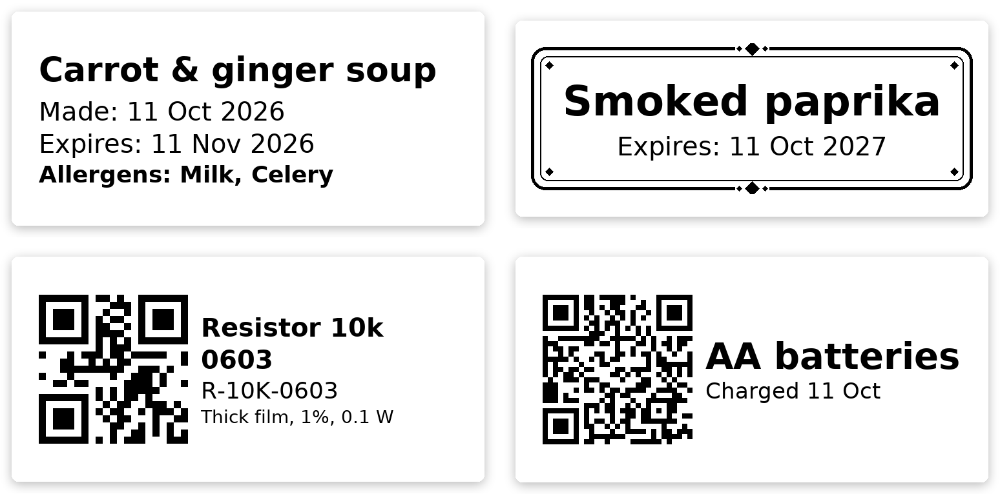
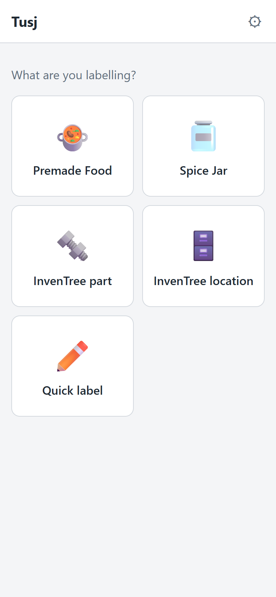
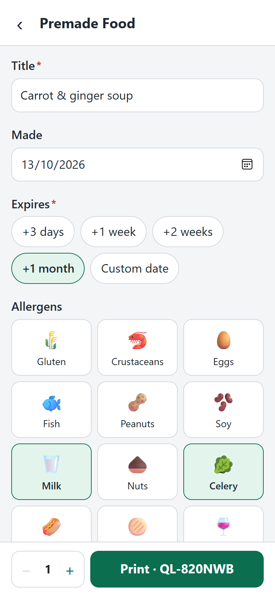
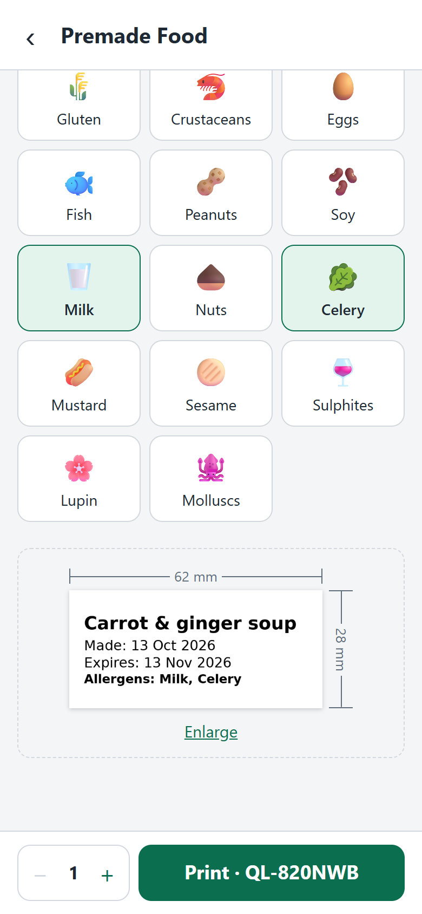
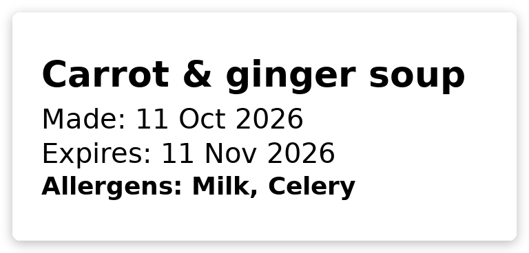
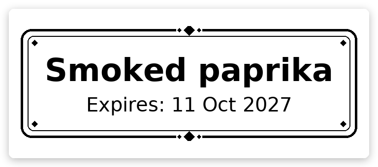
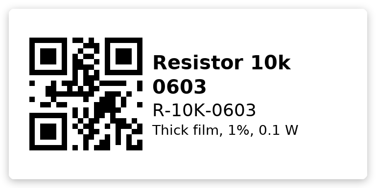
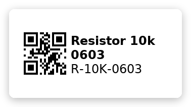

<h1 align="center">Tusj</h1>

<p align="center"><em>The marker pen for your kitchen — and your workshop.</em><br>
Print labels for freezer bags, leftovers, spice jars and parts bins from your phone, on a Brother QL label printer.</p>

<p align="center">
  
</p>

---

## What it does

- **Made for the phone.** Pick what you're labelling, fill in a few fields, see the label at real size, print.
- **Kitchen labels out of the box.** Premade food with made/expiry dates and the 14 allergens, spice jars with a decorative frame — or add your own as a YAML file.
- **Plugins for everything else.** Python plugins can fetch data and draw any label. Included: **InvenTree** part and location labels with a QR code the InvenTree app can scan, and a **quick label** with free text and a QR code.
- **Any QL printer, any tape.** Network, USB or Linux device; 12–102 mm endless tape. Several printers, a default per plugin, copies, and a "print again" list.
- **English and Norwegian**, and easy to translate. Labels print in the language you use.
- **Self-hosted.** Two small containers on a Raspberry Pi or any Linux box on your home network.

<p align="center">
  
  
  
</p>
<p align="center"><sub>Pick a label type → fill in → check the preview at real size → print. Dark mode follows your phone.</sub></p>

## Quick start

You need a Brother QL label printer on your network and a 64-bit Linux machine with [Podman](https://podman.io) or Docker — typically a Raspberry Pi. Run this on it:

```bash
curl -fsSL https://raw.githubusercontent.com/eiaro/tusj/main/scripts/raspberry-pi/install.sh | bash
```

The installer pulls prebuilt images, so nothing is compiled on the machine. Open **`http://<host>:8080`** on your phone, go to **⚙ Settings → Printers** and add your printer — **Find printer on the network** fills in the address and model for you. Details, updating and building from source are below.

### Raspberry Pi installation

Tusj needs a **64-bit OS**: on a Raspberry Pi 3, 4 or 5, install *Raspberry Pi OS Lite (64-bit)* with Raspberry Pi Imager. The installer stops with an explanation on a 32-bit OS.

The command above installs the current `main` build. To pin a release, set `TUSJ_IMAGE_TAG` (e.g. `v0.1.0-alpha`) in `/srv/tusj/.env`.

```bash
curl -fsSL https://raw.githubusercontent.com/eiaro/tusj/main/scripts/raspberry-pi/install.sh | bash
```

The installer downloads the source, then puts the application, `compose.yaml` and initial configuration in `/srv/tusj`. It pulls the prebuilt multi-architecture images from GHCR and starts Tusj. It prefers Podman when Podman Compose is available and otherwise uses Docker Compose. The install directory must be writable by the user running the command; prepare it if needed with `sudo install -d -o "$(id -u)" -g "$(id -g)" /srv/tusj`.

**Starting after a reboot.** With rootless Podman, the installer enables lingering for your user and `podman-restart.service`, so Tusj comes back after a reboot or power cut. If it isn't allowed to enable lingering, it prints the one command to run (`sudo loginctl enable-linger <user>`). With Docker, the Docker service must be enabled at boot.

**Updating.** Run the same command again. `config.yaml` and files you added to `templates/` or `plugins/` are kept. If you changed a file that ships with Tusj, it is replaced by the new version and your copy is kept next to it as `<file>.local-<date>` — give your own label types new file names to avoid that.

To choose Docker explicitly, pass `--docker` to the script:

```bash
curl -fsSL https://raw.githubusercontent.com/eiaro/tusj/main/scripts/raspberry-pi/install.sh | bash -s -- --docker
```

**USB printers.** Connect and switch on the printer, then add `--usb` (`… | bash -s -- --usb`, or `./scripts/raspberry-pi/install.sh --usb` from a checkout). The installer lists the Brother QL printers it finds, maps only those into the backend container, and tells you about any step that needs `sudo`. Then add the printer in Tusj with `usb://0x04f9:0x2042` (the ID it printed). Run it again with `--usb` after connecting another printer. Details, permissions, reboot behaviour and troubleshooting: [docs/usb-printers.md](docs/usb-printers.md).

GitHub Actions runs the backend tests and the frontend build first, then builds `linux/amd64` and `linux/arm64` images for pull requests and publishes them to GHCR on pushes to `main` (tagged `edge`) and version tags (`v*`). The first time the packages are published, make `tusj-backend` and `tusj-frontend` public in their GitHub package settings if the Pi should pull images without registry credentials.

<details>
<summary>Podman in WSL</summary>

Without systemd, builds fail with `sd-bus call: Permission denied`. Tell Podman to use cgroupfs in `~/.config/containers/containers.conf`:

```toml
[engine]
cgroup_manager = "cgroupfs"
events_logger = "file"
```
</details>

## Label types

| | |
|---|---|
|  | **Premade food** — title, made date, expiry from presets (+3 days … +1 month) or a custom date, and allergens. |
|  | **Spice jar** — big centred name in a decorative frame, optional expiry. Frames: `simple`, `double`, `ornate`. |
|  | **InvenTree part / location** — search as you type; the QR code uses your InvenTree's own barcode format, so scanning it in the InvenTree app opens the part. |
|  | **Quick label** — free text, small text and an optional symbol: a QR code (`QR https://…`, a link, a Wi-Fi password, anything), an emoji (`🔥`, `:tada:`, `:)`) or a [Material Design Icon](https://pictogrammers.com/library/mdi/) (`mdi:home`). |

Labels are drawn for the tape that is loaded, from 12 mm up to 102 mm — here the same part on 29 mm tape:



### Your own labels

- **A YAML file** in `templates/` is enough for simple labels — see `templates/premade_food.yaml`.
- **A Python plugin** in `plugins/<name>/plugin.py` can fetch data from anywhere and draw anything, with search-as-you-type fields, settings (including secrets) and its own translations. See **[docs/plugins.md](docs/plugins.md)**; `plugins/quick_label` is a small example and `plugins/inventree` a complete one.

Plugins are switched on and off, and configured, under **Settings → Plugins**.

## Printers

Set up printers under **Settings → Printers**. Each printer knows which tape is loaded, and the preview is drawn for the printer you print to.

- **Brother QL** over the network (`tcp://host`), USB (`usb://0x04f9:0x209d`) or a Linux device (`file:///dev/usb/lp0`).
- **Save as image** writes each label as a PNG to `prints/<printer id>/` instead of printing — handy for trying out a plugin without using labels.

The first printer is the default; each plugin can have its own default printer, and you can pick another printer and the number of copies when printing. Jobs to the same printer are queued. Settings shows whether each printer answers and lists the last 50 prints with **Print again**.

> Over the network a QL printer can't report back, so the status is "sent" — an empty roll or an open cover isn't detected. USB can report back.

## Configuration

Everything lives in `config.yaml` and most of it is edited from the app. It is not tracked by git because it holds plugin API tokens; `config.example.yaml` shows the format. `TUSJ_CONFIG=/path/to/other.yaml` points the backend at a different file.

| | |
|---|---|
| App | `http://<host>:8080` |
| API | `http://<host>:8000` — interactive docs at `/docs` |
| Health | `GET /health`, used by the container healthcheck |
| Mounted into the backend | `config.yaml`, `templates/`, `plugins/`, `prints/` |

## Translations

Tusj ships in English and Norwegian Bokmål; the language follows the browser and can be changed under Settings. To add a language, e.g. Swedish (`sv`):

1. Copy `frontend/src/locales/en.js` to `sv.js`, translate it, and register it in `frontend/src/i18n.svelte.js`.
2. Add `"sv"` to `LANGUAGES` in `backend/i18n.py` (and a date format in `format_date` if it differs from English).
3. Add `sv:` entries to the names and labels in `templates/*.yaml` and `backend/allergens.yaml`. Anything left out falls back to English.

## Development

| | |
|---|---|
| Backend | Python, FastAPI, Pillow, [brother_ql_next](https://github.com/LunarEclipse363/brother_ql_next) — `backend/` |
| Frontend | Svelte 5 + Vite — `frontend/` |
| Containers | `backend/Containerfile`, `frontend/Containerfile` (nginx), `compose.yaml` |

```bash
# Build and run the containers from source instead of pulling images
cp config.example.yaml config.yaml   # create it first, or the runtime makes a folder with that name
podman compose up -d --build

# Backend, with reload
cd backend && pip install -r requirements-dev.txt
uvicorn main:app --reload --port 8000

# Frontend; proxies /api to localhost:8000
cd frontend && npm install && npm run dev

# Tests (Linux/WSL: fake printers listen on loopback addresses)
cd backend && python -m pytest
```

The tests never touch your `config.yaml` or a real printer.

## Status

**Alpha** — it works, but expect rough edges. Known gaps:

- USB printing is written but not yet tested on real hardware.
- Die-cut labels aren't supported yet, and narrow tape (12 mm) would look better with rotated text.
- No login: anyone on your network can change the settings.
- The "recent prints" list is cleared when the backend restarts.

What's new is in the **[changelog](CHANGELOG.md)**, what's next in the **[roadmap](ROADMAP.md)**.

